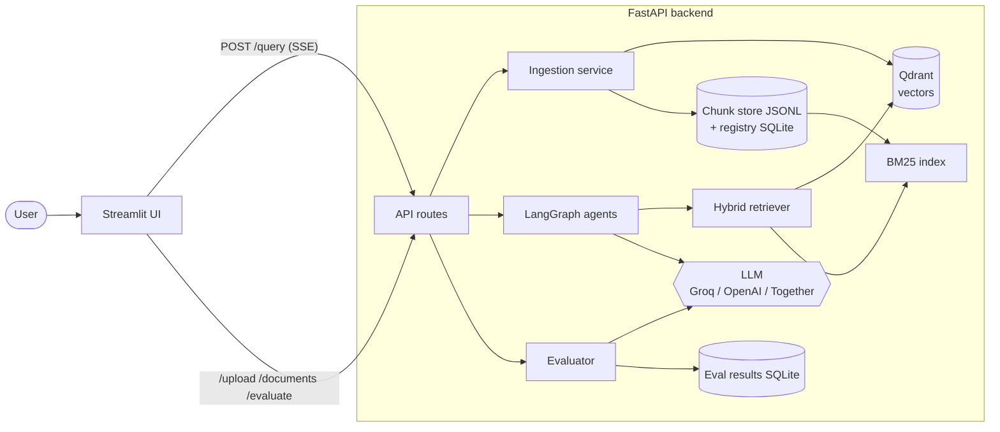
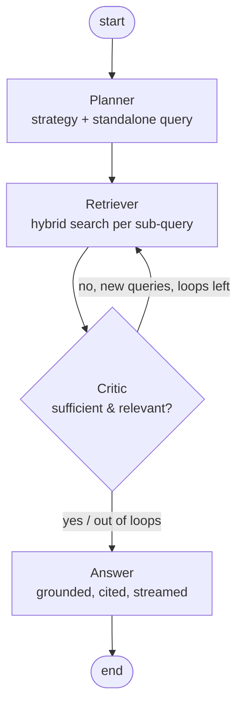

# Enterprise Knowledge Agent (EKA)

A production-style **multi-agent RAG system**: upload company documents, ask questions, and get streamed, cited answers
produced by a LangGraph pipeline of four cooperating agents over **hybrid (vector + BM25) retrieval** — with a built-in
**evaluation pipeline**, a **FastAPI** backend, a **Streamlit** UI, and one-command **Docker Compose** deployment.

| Chat with agent trace and highlighted citations | Evaluation dashboard |
|---|---|
|  |  |

> Screenshots were taken in **offline demo mode** (`LLM_PROVIDER=fake`, a keyless extractive stand-in for the LLM), which is
> why the sidebar shows the demo notice and the evaluation scores are heuristic. With a real Groq/OpenAI/Together key the
> agents use a real LLM.

## Features

- **Document ingestion** — PDF (with page numbers), DOCX (heading-aware, tables), TXT, Markdown (heading paths). Sentence-aware
  chunking with overlap, section/page metadata, de-duplication by content hash, replace-on-reupload by filename, atomic rollback on failure.
- **Hybrid retrieval** — dense vectors in **Qdrant** + keyword **BM25** (`rank_bm25`), fused by weighted min-max scores
  (default) or Reciprocal Rank Fusion. Per-document filtering. Falls back to BM25 if the vector side fails.
- **Multi-agent graph (LangGraph)** — Planner → Retriever → Critic → (re-retrieve ≤ N times) → Answer, with typed state,
  streaming events, and per-node graceful degradation.
- **Streaming** — Server-Sent Events: agent steps *and* answer tokens arrive as they are produced.
- **Citations** — answers cite `[n]` sources; citations that don't map to a retrieved chunk are stripped; the UI highlights the
  source sentence that supports each cited claim.
- **Evaluation** — faithfulness, answer relevancy, context precision, context recall via a custom LLM-as-judge
  (Ragas definitions), with an optional **Ragas** backend. Single, batch (background), and automatic post-answer scoring; results stored in SQLite.
- **Conversation memory** — recent turns are sent with each question; the Planner rewrites follow-ups into standalone queries.
- **Switchable providers** — Groq (default) / OpenAI / Together for the LLM; local `sentence-transformers` or OpenAI for embeddings.
- **Docker Compose** — Qdrant + backend + frontend, health-checked, persistent volumes.

## Architecture



### The agent graph



| Agent | Responsibility | If it fails |
|---|---|---|
| **Planner** | Picks `direct` / `multi_query` / `decompose`, rewrites follow-ups into standalone queries | Falls back to searching the raw question |
| **Retriever** | Runs every planned query through the hybrid retriever, merges + de-duplicates results across passes | Reports the error; the Critic is skipped and no pointless retry loop starts |
| **Critic** | Scores relevance/coverage, selects the useful sources, proposes *new* queries (never repeats one) | Accepts the retrieved context |
| **Answer** | Streams an answer using only numbered sources; deterministic refusal when nothing was retrieved | Emits an `error` event, then `done` with `ok: false` |

The re-retrieval loop is bounded by `MAX_RETRIEVAL_LOOPS` (enforced in both the Critic and the router). The compiled graph is
exported to [`docs/agent_graph.md`](docs/agent_graph.md) (`python scripts/export_graph.py`; a test fails if it drifts).

### Key design decisions

| Decision | Why |
|---|---|
| Weighted fusion (vector weight 0.7) is the default; RRF is available | On the bundled benchmark RRF let BM25 noise outrank correct dense hits on paraphrased questions (see results below). The weight was chosen on that same small set — treat it as a sensible starting point, not a tuned optimum |
| BM25 uses Lucene-style IDF (`ln(1 + (N-n+0.5)/(n+0.5))`) + light stemming | Stock `rank_bm25` IDF goes negative for common terms and misbehaves on tiny corpora |
| Identifier-aware tokenizer (`ERR-5031` → `err-5031`, `err`, `5031`) | Error codes / policy IDs are exactly where keyword search beats embeddings |
| Chunk text is embedded together with its section title | Policy paragraphs rarely repeat their heading, but users ask by topic |
| Provider abstractions (`LLMClient`, `Embedder`) with deterministic fakes | Every test runs offline, with no API key or model download |
| An `OfflineLLM` for `LLM_PROVIDER=fake` | Lets you try the whole stack keyless; clearly labelled in the UI |
| Embedded Qdrant locally, Qdrant server in Docker | Same code path; zero-setup development |

## Quick start

### Option A — Docker Compose

```bash
cp .env.example .env          # then set GROQ_API_KEY=...   (or LLM_PROVIDER=fake for a keyless demo)
docker compose up --build
```

- UI: <http://localhost:8501> · API docs: <http://localhost:8000/docs> · Qdrant: <http://localhost:6333/dashboard>
- Click **Load samples** in the sidebar to index the bundled Acme Corp documents, then ask away.
- The backend image bakes in `all-MiniLM-L6-v2` (CPU PyTorch) and runs with `HF_HUB_OFFLINE=1`; to use a different embedding model, edit the
  model name in `docker/Dockerfile.backend` and rebuild.

### Option B — Local

```bash
python -m venv .venv && source .venv/bin/activate        # Windows: .venv\Scripts\activate
pip install -r requirements-dev.txt          # add  -c constraints.txt  for the exact versions the tests ran against
cp .env.example .env                                      # set GROQ_API_KEY (or LLM_PROVIDER=fake)

uvicorn app.main:app --reload --port 8000                 # terminal 1: backend
streamlit run frontend/app.py                             # terminal 2: UI  (BACKEND_URL defaults to http://localhost:8000)
```

The first start downloads the embedding model (~90 MB). Local mode stores vectors in `data/qdrant` (single process); set
`QDRANT_URL` to use a Qdrant server instead.

## Configuration

All settings are environment variables (see [`.env.example`](.env.example)).

| Variable | Default | Meaning |
|---|---|---|
| `LLM_PROVIDER` | `groq` | `groq` \| `openai` \| `together` \| `fake` (offline demo) |
| `LLM_MODEL` | provider default | Groq default `openai/gpt-oss-120b`; e.g. `openai/gpt-oss-20b`, `gpt-4o-mini` |
| `GROQ_API_KEY` / `OPENAI_API_KEY` / `TOGETHER_API_KEY` | – | Key for the selected provider |
| `EMBEDDING_PROVIDER` | `sentence-transformers` | `sentence-transformers` \| `openai` \| `fake` |
| `EMBEDDING_MODEL` / `EMBEDDING_DIM` | `all-MiniLM-L6-v2` / `384` | Changing the model needs a new `QDRANT_COLLECTION` (dimension is checked at startup) |
| `QDRANT_URL` / `QDRANT_PATH` / `QDRANT_COLLECTION` | empty / `data/qdrant` / `eka_chunks` | Server URL, or embedded storage path |
| `CHUNK_SIZE` / `CHUNK_OVERLAP` | `800` / `120` | Characters |
| `MAX_UPLOAD_MB` | `25` | Per-file upload limit |
| `RETRIEVAL_TOP_K` | `5` | Sources per search |
| `FUSION_METHOD` / `VECTOR_WEIGHT` / `RRF_K` | `weighted` / `0.7` / `60` | Hybrid fusion |
| `MAX_RETRIEVAL_LOOPS` | `2` | Max Critic-triggered re-retrievals |
| `MAX_HISTORY_TURNS` | `6` | Conversation turns forwarded to the agents |
| `EVAL_BACKEND` | `custom` | `custom` \| `ragas` |
| `EVAL_AFTER_QUERY` | `false` | Score every answer in the background |
| `BACKEND_URL` | `http://localhost:8000` | Used by the Streamlit frontend |

## API

Interactive docs at `/docs`. Main endpoints:

| Method & path | Purpose |
|---|---|
| `POST /upload` | Multipart upload of one or more files. `200` with per-file results if any file was indexed; otherwise `415` unsupported type, `413` too large, `422` empty/corrupt |
| `GET /documents` · `GET /documents/{id}` · `DELETE /documents/{id}` | List / inspect / remove documents (also removes vectors and keyword entries) |
| `POST /samples/load` | Index the bundled sample corpus |
| `POST /query` | Ask a question. `stream: true` (default) → `text/event-stream`; `stream: false` → one JSON object |
| `POST /evaluate` | Answer a question with the full pipeline and score it (optional `ground_truth` enables context recall) |
| `POST /evaluate/batch` | Start a background batch (`use_sample` or inline `cases`) → `202` with a run to poll |
| `GET /evaluations` · `/evaluations/{id}` · `/evaluations/runs` · `/evaluations/runs/{id}` | Stored results, aggregates, runs |
| `GET /health` | Status, provider/model, document count |

```bash
curl -N -X POST localhost:8000/query -H 'content-type: application/json' \
  -d '{"question": "What is the minimum password length?", "top_k": 5, "history": []}'
```

**SSE events** (`event: <type>` + one-line JSON `data:`): `plan` → `retrieval` → `critique` (repeats per re-retrieval) → `token`* → `citations` → `done`.
An `error` event may precede `done` (`ok: false`); errors after the stream starts are reported in-band.

| Event | Payload highlights |
|---|---|
| `plan` | `strategy`, `standalone_query`, `sub_queries`, `fallback` |
| `retrieval` | `iteration`, `queries`, `chunks[]` (file, page, section, score, which retrievers found it) |
| `critique` | `sufficient`, `confidence`, `missing_information`, `rewritten_queries`, `will_retry` |
| `token` | `text` |
| `citations` | `citations[]` (cited sources, with full text) and `sources[]` (everything given to the model) |
| `done` | `ok`, `answer` (final, citation-cleaned), `grounded`, `iterations`, `elapsed_ms`, `trace`, `errors` |

## Evaluation

| Metric | Definition (Ragas-style) |
|---|---|
| **Faithfulness** | supported claims ÷ claims in the answer (claims extracted and verified against the retrieved contexts by the judge LLM) |
| **Answer relevancy** | mean cosine(question, questions the judge regenerates from the answer); 0 for evasive answers |
| **Context precision** | rank-aware average precision over retrieved contexts judged useful |
| **Context recall** | reference-answer statements attributable to the contexts (needs a ground truth) |

```bash
python -m app.evaluation.run --ingest-samples --limit 12 --json results.json   # CLI batch over data/eval/questions.json
```

…or use the **Evaluation** page in the UI, `POST /evaluate`, or the *Score each answer* toggle. A failing metric becomes `null`
with an error note instead of failing the whole evaluation. `EVAL_BACKEND=ragas` runs the real Ragas 0.4 metrics through
the same interface (`app/evaluation/ragas_adapter.py`).

> **Important:** with `LLM_PROVIDER=fake` the judge is a keyword-overlap heuristic that only exercises the pipeline; its scores say
> nothing about answer quality. Use a real judge model for real numbers.

## Retrieval benchmark (measured)

[`scripts/benchmark_retrieval.py`](scripts/benchmark_retrieval.py) on the bundled corpus (4 documents → 17 chunks) with 36 labelled
questions — 18 *standard*, 10 *paraphrase* (little word overlap with the source), 8 *keyword* (exact identifiers) — using
`all-MiniLM-L6-v2`. A hit needs the right document **and** the labelled evidence string in the chunk. Recall@3 / MRR@3
(raw numbers in [`docs/benchmark_results.json`](docs/benchmark_results.json)):

| Retrieval | all | keyword | paraphrase | standard |
|---|---|---|---|---|
| vector only | 0.99 / 0.95 | 1.00 / 1.00 | 1.00 / 0.83 | 0.97 / 1.00 |
| BM25 only | 0.89 / 0.83 | 1.00 / 0.94 | 0.60 / 0.50 | 1.00 / 0.97 |
| hybrid (RRF) | 0.94 / 0.90 | 1.00 / 1.00 | 0.80 / 0.68 | 1.00 / 0.97 |
| hybrid (weighted 0.5) | 0.97 / 0.88 | 1.00 / 0.94 | 0.90 / 0.68 | 1.00 / 0.97 |
| **hybrid (weighted 0.7) — default** | **1.00 / 0.94** | 1.00 / 1.00 | 1.00 / 0.83 | 1.00 / 0.97 |

**How to read this honestly:** BM25 alone fails paraphrased questions (0.60) and dense retrieval alone is already near-perfect on
this *tiny* corpus, so hybrid retrieval matches the best single method rather than clearly beating it (1.00 vs 0.99 recall is one
question). RRF was *worse* than vector-only on paraphrases here. The vector weight was picked after looking at this same set. Hybrid's
advantage is expected to grow with corpus size and identifier-heavy content — **re-run the benchmark on your own documents before
claiming any improvement.**

## Project structure

```
app/
  api/          FastAPI routes (documents, query/SSE, evaluate, health), schemas, SSE formatting, DI
  agents/       planner, retriever, critic, answerer, graph (LangGraph), prompts, state
  retrieval/    bm25, hybrid_retriever (fusion), metrics (recall/MRR)
  ingestion/    loaders (PDF/DOCX/TXT/MD), chunker, registry + chunk store, indexer (IngestionService)
  evaluation/   metrics (LLM judge), evaluator, store (SQLite), ragas_adapter, offline judge, CLI (run.py)
  core/         config (pydantic-settings), llm clients, embeddings, vectorstore (Qdrant), container, logging
frontend/       Streamlit app, backend client (SSE parser), UI helpers
data/           sample_docs (md/docx/txt/pdf) and eval/questions.json (36 labelled questions)
docker/         Dockerfile.backend, Dockerfile.frontend        docker-compose.yml
scripts/        generate_sample_docs.py, export_graph.py, benchmark_retrieval.py
tests/          372 tests (+2 slow, real-model)
```

## Testing

```bash
pytest -q                 # 372 tests, offline, no API key, ~20 s
pytest -m slow            # + real sentence-transformers model (downloads ~90 MB)
ruff check .
```

Highlights: chunker invariants (size/overlap/no lost text), BM25 and fusion maths against hand-computed values, agent loop caps and
failure degradation for every node, strict SSE frame parsing, background-task behaviour, the real Ragas metric code driven by a scripted
LLM, and the Streamlit script driven by `streamlit.testing.AppTest`.

## Verification status & limitations

- **Live LLM check (Groq, `openai/gpt-oss-120b`, free tier):** 9 sample questions (standard + paraphrased) and one streamed multi-document
  question ran end to end with correct, cited answers and no errors; faithfulness, context precision and context recall were 1.0 on every
  question evaluated (answer relevancy 0.31–0.95 — it is sensitive to the embedder and noisy on short answers). That is a small smoke test,
  not a benchmark. The free tier's token-per-minute limit triggers retries (the client honours the provider's wait hint), so batches are slow.
  OpenAI and Together are supported through the same client but were **not** run live. Pick a model your account can access via `LLM_MODEL`.
- The benchmark corpus is small and synthetic (see above); the evaluation scores shown in screenshots are from the offline heuristic judge.
- Scanned (image-only) PDFs have no extractable text and are rejected; there is no OCR.
- No authentication or multi-tenancy; CORS is open by default (`CORS_ORIGINS`). Conversation history lives in the browser session.
- Embedded Qdrant (`QDRANT_PATH`) is single-process; use `QDRANT_URL` / Docker Compose for anything shared.
- The demo video and a hosted live demo are not included.

**Roadmap:** authentication, hosted demo, server-side conversation store, reranker, OCR, streaming evaluation progress.

## Demo video (record it yourself in ~2 minutes)

1. `docker compose up --build`, open the UI → **Load samples**.
2. Ask *"What does ERR-5031 mean and how do I fix it?"* — expand **How the agents answered** and a highlighted source.
3. Ask *"If a SEV-1 incident exposes EU customer data, what must happen and by when?"* — shows multi-source citations.
4. Toggle **Score each answer**, then open **Evaluation** → **Run batch**.

## Resume bullets (replace the bracketed numbers with *your* measured results)

- Designed and built a multi-agent RAG system with **LangGraph** (Planner, Retriever, Critic, Answer) featuring a bounded re-retrieval loop,
  per-agent graceful degradation, and token-level **SSE streaming** through a **FastAPI** backend.
- Implemented **hybrid retrieval** (Qdrant dense vectors + BM25, weighted/RRF fusion) and a reproducible benchmark; on a 36-question labelled set hybrid reached
  recall@3 = 1.00 vs 0.99 (vector-only) and 0.89 (BM25-only) — [report your own corpus numbers here].
- Built an **evaluation pipeline** (faithfulness, answer relevancy, context precision/recall) with a custom LLM-as-judge and an optional **Ragas** backend, batch/background runs, and a results dashboard.
- Shipped a production-style stack: **Streamlit** UI with highlighted citations, **Docker Compose** (Qdrant + API + UI), and 370+ automated offline tests.
