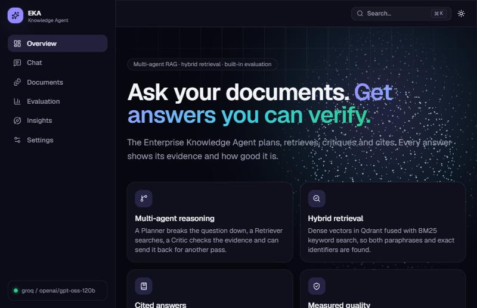
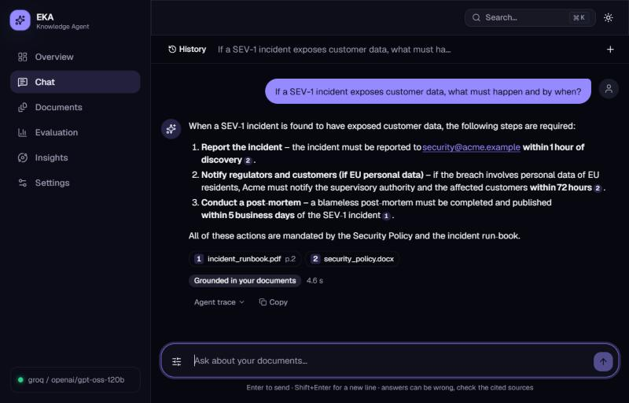
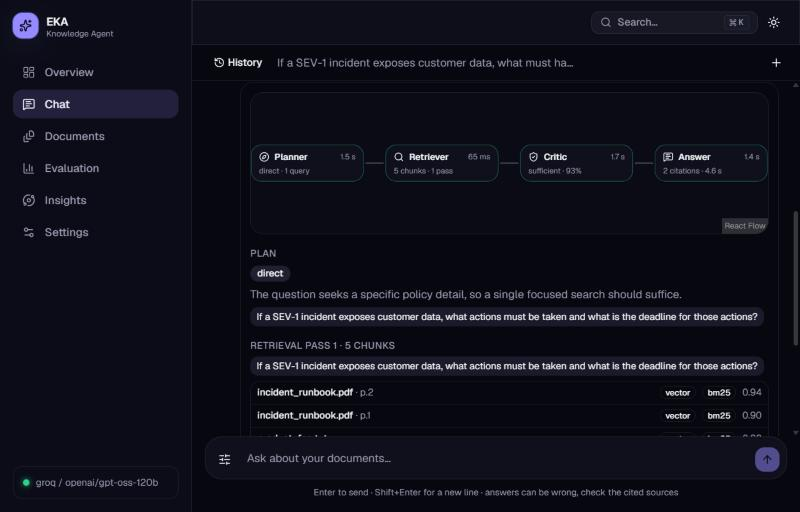
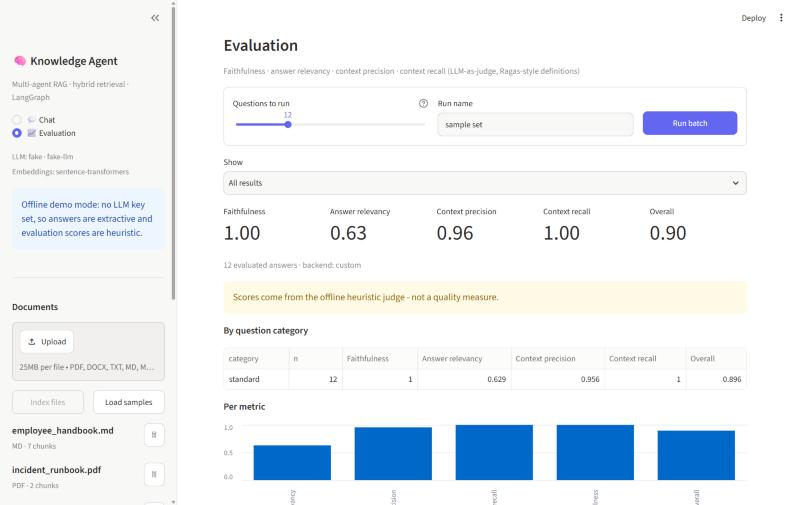
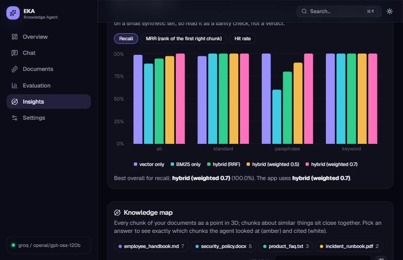
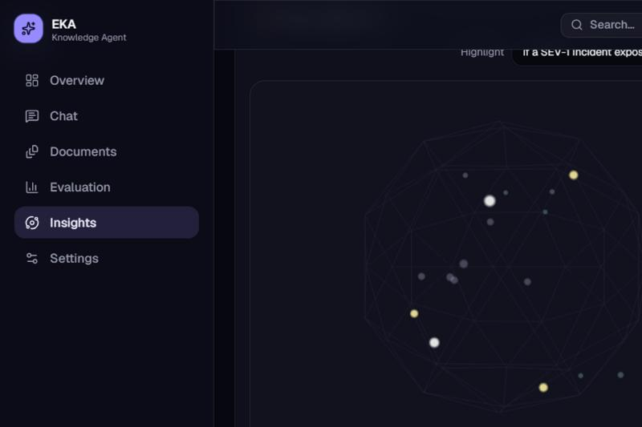
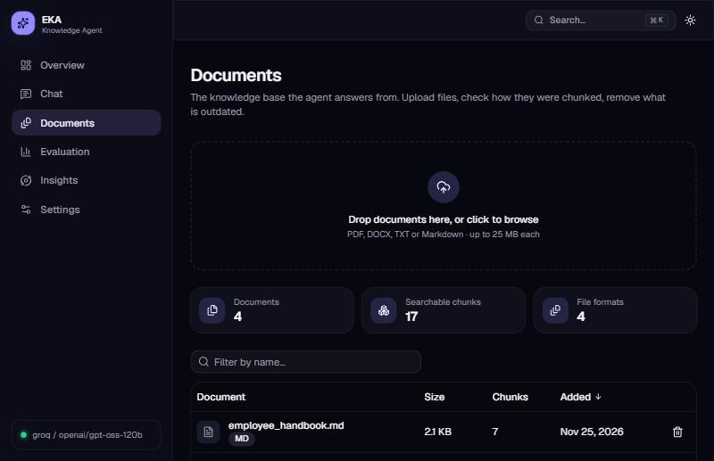
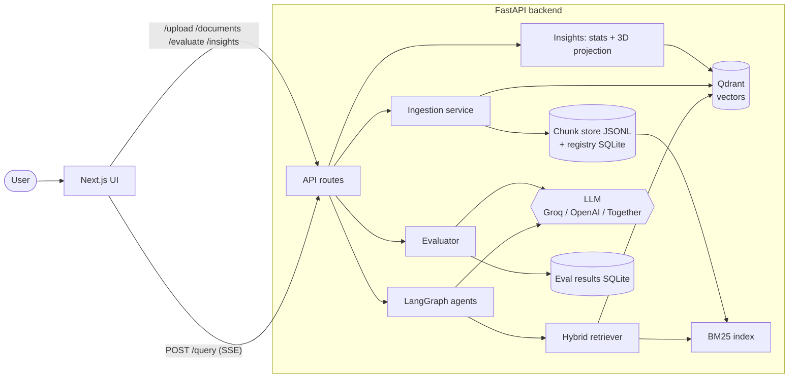

# Enterprise Knowledge Agent (EKA)

A **multi-agent RAG system** you can actually look inside. Upload company documents, ask questions, and get streamed, cited
answers produced by a LangGraph pipeline of four cooperating agents over **hybrid (vector + BM25) retrieval**, with a built-in
**evaluation pipeline** and a **Next.js + TypeScript** interface that shows the agents working, the evidence behind every claim,
the quality scores, and a **3D map** of your knowledge base.

| Landing: three.js orb | Chat: streamed answer with clickable citations |
|---|---|
|  |  |

| Agent trace: the four agents, timings, retrieval, critic | Evaluation: RAG metrics and runs |
|---|---|
|  |  |

| Insights: retrieval benchmark | 3D knowledge map: retrieved (amber) and cited (white) chunks |
|---|---|
|  |  |

| Documents: upload, sort, delete |
|---|
|  |

> Screenshots are from the real stack: Groq `openai/gpt-oss-120b` (free tier) answering over the bundled sample documents.

## Repository layout

```
backend/                FastAPI + LangGraph service (Python 3.12)
  app/                  api, agents, retrieval, ingestion, evaluation, core
  tests/  scripts/  data/  docs/  Dockerfile  requirements*.txt  constraints.txt
web/                    Next.js 16 + React 19 + TypeScript UI
  src/app/              routes: / /chat /documents /evaluation /insights /settings
  src/components/       feature components; ui/ = shadcn primitives
  src/lib/              typed API client, SSE parser, chat/eval/insights logic, stores
docker-compose.yml      Qdrant + backend + web
.github/workflows/      CI: backend, web, docker
```

## Features

- **Document ingestion**: PDF (page numbers), DOCX (headings, tables), TXT, Markdown. Sentence-aware chunking with overlap,
  section/page metadata, de-duplication by content hash, replace-on-reupload, atomic rollback on failure.
- **Hybrid retrieval**: dense vectors in **Qdrant** + keyword **BM25**, fused by weighted min-max scores (default) or RRF.
  Per-document filtering. Falls back to BM25 if the vector side fails.
- **Multi-agent graph (LangGraph)**: Planner, Retriever, Critic (re-retrieve up to N times), Answer, with typed state, streamed
  events and per-node graceful degradation.
- **Cited answers**: `[n]` markers that do not map to a retrieved chunk are stripped. In the UI each marker is a chip that opens
  the source with the sentence that best supports the claim highlighted.
- **Evaluation**: faithfulness, answer relevancy, context precision, context recall via a custom LLM-as-judge (Ragas definitions)
  with an optional Ragas backend; single, batch (background) and automatic post-answer scoring, stored in SQLite.
- **Insights**: retrieval benchmark chart and a 3D knowledge map (PCA of the real chunk embeddings) that highlights which chunks an
  answer retrieved and cited.
- **Switchable providers**: Groq (default) / OpenAI / Together for the LLM; local `sentence-transformers` or OpenAI for embeddings.

## Frontend stack and why

| Concern | Choice | Why |
|---|---|---|
| Framework | **Next.js 16 (App Router), React 19, TypeScript strict** | Standard for AI products; file routing, server/client split |
| UI | **Tailwind CSS v4, shadcn/ui (Base UI primitives), lucide, Framer Motion, sonner, cmdk** | Accessible components that live in the repo; polished dark/light theme, command palette (Ctrl/Cmd+K) |
| Server state | **TanStack Query** | Caching, polling for running evaluations, retries |
| Client state | **Zustand** (persisted) | Conversations and settings that survive a refresh |
| Forms | **React Hook Form + Zod** | Typed validation; Zod also validates every API response |
| Data viz | **Recharts**, **TanStack Table v8** | Radar / line / bar charts, sortable paginated tables |
| Agent trace | **React Flow** | The four agents as a diagram lit up by the real SSE events |
| 3D | **three.js via @react-three/fiber + drei** | Knowledge map and landing orb. Lazy loaded, 2D fallback without WebGL, still for reduced motion |
| Tests | **Vitest, Testing Library, MSW** | Components and flows run against a mocked API |

A 3D visualisation of the *agent pipeline* was deliberately not built: a flat diagram is easier to read. three.js is used only where
the third dimension carries information (the embedding map).

## Architecture



### The agent graph


| Agent | Responsibility | If it fails |
|---|---|---|
| **Planner** | Picks `direct` / `multi_query` / `decompose`, rewrites follow-ups into standalone queries | Falls back to searching the raw question |
| **Retriever** | Runs every planned query through the hybrid retriever, merges and de-duplicates across passes | Reports the error; no pointless retry loop |
| **Critic** | Scores relevance/coverage, picks the useful sources, proposes *new* queries (never repeats one) | Accepts the retrieved context |
| **Answer** | Streams an answer using only numbered sources; deterministic refusal when nothing was retrieved | Emits an `error` event, then `done` with `ok: false` |

The loop is bounded by `MAX_RETRIEVAL_LOOPS`. The compiled graph is exported to
[`backend/docs/agent_graph.md`](backend/docs/agent_graph.md); a test fails if it drifts.

### Key design decisions

| Decision | Why |
|---|---|
| Weighted fusion (vector weight 0.7) is the default; RRF is available | On the bundled benchmark RRF let BM25 noise outrank correct dense hits on paraphrased questions. The weight was chosen on that same small set, so treat it as a starting point |
| BM25 uses Lucene-style IDF and light stemming | Stock `rank_bm25` IDF goes negative for common terms on tiny corpora |
| Identifier-aware tokenizer (`ERR-5031` becomes `err-5031`, `err`, `5031`) | Error codes and policy IDs are where keyword search beats embeddings |
| Chunk text is embedded together with its section title | Policy paragraphs rarely repeat their heading |
| Provider abstractions with deterministic fakes | Every backend test runs offline with no key or model download |
| The browser talks to the API directly (CORS), SSE through `fetch` | No proxy buffering of token streams; the API URL is editable in Settings |
| Zod validates every API response | A backend change fails loudly instead of rendering `undefined` |

## Quick start

### Option A: Docker Compose

```bash
cp backend/.env.example backend/.env    # then set GROQ_API_KEY=...   (or LLM_PROVIDER=fake for a keyless demo)
docker compose up --build
```

- UI: <http://localhost:3000> · API docs: <http://localhost:8000/docs> · Qdrant: <http://localhost:6333/dashboard>
- Open **Documents**, click **Load sample documents**, then ask in **Chat**.
- The web image is built with `NEXT_PUBLIC_API_URL=http://localhost:8000` (the *browser* calls the API). Behind another host name, set
  `PUBLIC_API_URL` when building, or change the URL on the **Settings** page.

### Option B: Local development

```bash
# backend (terminal 1)
cd backend
python -m venv ../.venv && source ../.venv/bin/activate      # Windows: ..\.venv\Scripts\activate
pip install -r requirements-dev.txt                          # add  -c constraints.txt  for the exact tested versions
cp .env.example .env                                         # set GROQ_API_KEY (or LLM_PROVIDER=fake)
uvicorn app.main:app --reload --port 8000

# web (terminal 2)
cd web
pnpm install
pnpm dev                                                     # http://localhost:3000
```

The first backend start downloads the embedding model (~90 MB). Local mode keeps vectors in `backend/data/qdrant` (single process);
set `QDRANT_URL` to use a Qdrant server.

## Configuration

All backend settings are environment variables (see [`backend/.env.example`](backend/.env.example)).

| Variable | Default | Meaning |
|---|---|---|
| `LLM_PROVIDER` | `groq` | `groq` \| `openai` \| `together` \| `fake` (offline demo) |
| `LLM_MODEL` | provider default | Groq default `openai/gpt-oss-120b`; e.g. `openai/gpt-oss-20b`, `gpt-4o-mini` |
| `GROQ_API_KEY` / `OPENAI_API_KEY` / `TOGETHER_API_KEY` | none | Key for the selected provider |
| `EMBEDDING_PROVIDER` | `sentence-transformers` | `sentence-transformers` \| `openai` \| `fake` |
| `EMBEDDING_MODEL` / `EMBEDDING_DIM` | `all-MiniLM-L6-v2` / `384` | Changing the model needs a new `QDRANT_COLLECTION` (dimension is checked at startup) |
| `QDRANT_URL` / `QDRANT_PATH` / `QDRANT_COLLECTION` | empty / `data/qdrant` / `eka_chunks` | Server URL, or embedded storage path |
| `CHUNK_SIZE` / `CHUNK_OVERLAP` | `800` / `120` | Characters |
| `MAX_UPLOAD_MB` | `25` | Per-file upload limit |
| `RETRIEVAL_TOP_K` | `5` | Sources per search |
| `FUSION_METHOD` / `VECTOR_WEIGHT` / `RRF_K` | `weighted` / `0.7` / `60` | Hybrid fusion |
| `MAX_RETRIEVAL_LOOPS` | `2` | Max Critic-triggered re-retrievals |
| `EVAL_BACKEND` | `custom` | `custom` \| `ragas` |
| `EVAL_AFTER_QUERY` | `false` | Score every answer in the background |
| `CORS_ORIGINS` | `*` | Comma-separated allowed origins; restrict this in production |
| `BENCHMARK_RESULTS_PATH` | `docs/benchmark_results.json` | Benchmark file shown on the Insights page |

Web: `NEXT_PUBLIC_API_URL` (build time, default `http://localhost:8000`), also editable at runtime on **Settings**.

## API

Interactive docs at `/docs`.

| Method & path | Purpose |
|---|---|
| `POST /upload` | Multipart upload of one or more files. `200` with per-file results if any was indexed; otherwise `415` unsupported type, `413` too large, `422` empty/corrupt |
| `GET /documents` · `GET /documents/{id}` · `DELETE /documents/{id}` | List / inspect / remove documents (also removes vectors and keyword entries) |
| `POST /samples/load` | Index the bundled sample corpus |
| `POST /query` | Ask a question. `stream: true` (default) is `text/event-stream`; `stream: false` returns one JSON object |
| `POST /evaluate` | Answer a question with the full pipeline and score it (optional `ground_truth` enables context recall) |
| `POST /evaluate/batch` | Start a background batch (`use_sample` or inline `cases`), returns `202` with a run to poll |
| `GET /evaluations` · `/evaluations/{id}` · `/evaluations/runs` · `/evaluations/runs/{id}` | Stored results, aggregates, runs |
| `GET /insights/stats` | Corpus counts, active models, evaluation summary, retrieval benchmark |
| `GET /insights/map` | Every chunk projected to 3D (PCA of its embedding); `max_points`, `doc_ids` |
| `GET /health` | Status, provider/model, document count |

```bash
curl -N -X POST localhost:8000/query -H 'content-type: application/json' \
  -d '{"question": "What is the minimum password length?", "top_k": 5, "history": []}'
```

**SSE events** (`event: <type>` + one-line JSON `data:`): `plan`, `retrieval`, `critique` (repeats per re-retrieval), `token`*, `citations`, `done`.
An `error` event may precede `done` (`ok: false`).

| Event | Payload highlights |
|---|---|
| `plan` | `strategy`, `standalone_query`, `sub_queries`, `fallback` |
| `retrieval` | `iteration`, `queries`, `chunks[]` (file, page, section, score, which retrievers found it) |
| `critique` | `sufficient`, `confidence`, `missing_information`, `rewritten_queries`, `will_retry` |
| `token` | `text` |
| `citations` | `citations[]` (cited sources, full text) and `sources[]` (everything given to the model) |
| `done` | `ok`, `answer` (final, citation-cleaned), `grounded`, `iterations`, `elapsed_ms`, `trace`, `errors` |

## Evaluation

| Metric | Definition (Ragas-style) |
|---|---|
| **Faithfulness** | supported claims / claims in the answer (extracted and verified against the retrieved contexts by the judge LLM) |
| **Answer relevancy** | mean cosine(question, questions the judge regenerates from the answer); 0 for evasive answers |
| **Context precision** | rank-aware average precision over retrieved contexts judged useful |
| **Context recall** | reference-answer statements attributable to the contexts (needs a ground truth) |

```bash
cd backend && python -m app.evaluation.run --ingest-samples --limit 12 --json results.json
```

Or use the **Evaluation** page, `POST /evaluate`, or the "Score answers in the background" option in Chat. A failing metric becomes
`null` with an error note instead of failing the whole evaluation, and unscored metrics are left out of averages rather than counted as zero.

> With `LLM_PROVIDER=fake` the judge is a keyword-overlap heuristic that only exercises the pipeline; its scores say nothing about
> answer quality. Use a real judge model for real numbers.

## Retrieval benchmark (measured)

[`backend/scripts/benchmark_retrieval.py`](backend/scripts/benchmark_retrieval.py) on the bundled corpus (4 documents, 17 chunks)
with 36 labelled questions: 18 *standard*, 10 *paraphrase* (little word overlap with the source), 8 *keyword* (exact identifiers),
using `all-MiniLM-L6-v2`. A hit needs the right document **and** the labelled evidence string in the chunk. Recall@3 / MRR@3 (raw numbers
in [`backend/docs/benchmark_results.json`](backend/docs/benchmark_results.json), also charted on the Insights page):

| Retrieval | all | keyword | paraphrase | standard |
|---|---|---|---|---|
| vector only | 0.99 / 0.95 | 1.00 / 1.00 | 1.00 / 0.83 | 0.97 / 1.00 |
| BM25 only | 0.89 / 0.83 | 1.00 / 0.94 | 0.60 / 0.50 | 1.00 / 0.97 |
| hybrid (RRF) | 0.94 / 0.90 | 1.00 / 1.00 | 0.80 / 0.68 | 1.00 / 0.97 |
| hybrid (weighted 0.5) | 0.97 / 0.88 | 1.00 / 0.94 | 0.90 / 0.68 | 1.00 / 0.97 |
| **hybrid (weighted 0.7), default** | **1.00 / 0.94** | 1.00 / 1.00 | 1.00 / 0.83 | 1.00 / 0.97 |

**Read this honestly:** BM25 alone fails paraphrased questions (0.60) and dense retrieval alone is already near-perfect on this *tiny*
corpus, so hybrid matches the best single method rather than clearly beating it (1.00 vs 0.99 recall is one question). RRF was *worse*
than vector-only on paraphrases here. The vector weight was picked after looking at this same set. Hybrid's advantage is expected to grow
with corpus size and identifier-heavy content; re-run the benchmark on your own documents before claiming any improvement.

## Testing

```bash
cd backend && pytest -q          # 368 tests, offline, no API key, ~25 s   (pytest -m slow adds the real embedding model)
cd backend && ruff check app tests scripts
cd web && pnpm lint && pnpm typecheck && pnpm test && pnpm build      # 298 tests
```

CI (`.github/workflows/ci.yml`) runs all of this on every pull request, plus `docker compose config` and a web image build.

Highlights: chunker invariants, BM25 and fusion maths against hand-computed values, agent loop caps and failure degradation for every
node, strict SSE frame parsing on both sides (Python and TypeScript), citation parsing and evidence highlighting, graph/trace builders,
PCA projection properties, and component flows against a mocked API.

## Git history

This repository was rebuilt as a sequence of feature branches, each tested on its own and merged by pull request into `main` with the
full suites re-run afterwards: backend core, ingestion, hybrid retrieval, agent graph, API, evaluation, insights endpoints, web
foundation, documents, chat, evaluation dashboard, 3D insights, Docker + CI, and docs. The earlier single-branch history is kept on the
`archive/single-branch-original` branch.

## Verification status and limitations

- **Live LLM check** (Groq `openai/gpt-oss-120b`, free tier): sample and paraphrased questions, a streamed multi-document question, and
  questions over the Claude API documentation ran end to end with cited answers. That is a smoke test, not a benchmark. The free tier's
  token-per-minute limit triggers retries (the client honours the provider's wait hint), so batches are slow and one metric occasionally
  fails after retries. OpenAI and Together use the same client but were **not** run live.
- The benchmark corpus is small and synthetic (see above).
- Scanned (image-only) PDFs have no extractable text and are rejected; there is no OCR.
- No authentication or multi-tenancy; CORS is open by default. Conversation history lives in the browser (localStorage).
- Embedded Qdrant (`QDRANT_PATH`) is single-process; use `QDRANT_URL` / Docker Compose for anything shared.
- The 3D views need WebGL (a 2D view is shown otherwise) and were checked in one browser; the hero and map are decorative/analytical aids,
  not required to use the product.
- Not deployed anywhere; there is no hosted demo and no demo video.

**Roadmap:** authentication, hosted demo, server-side conversation store, reranker, OCR, end-to-end browser tests.
