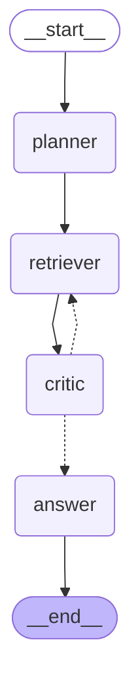

# Agent graph

Generated from the compiled LangGraph `StateGraph` by `scripts/export_graph.py` (do not edit by hand).

* **planner** - analyses the question, picks `direct` / `multi_query` / `decompose`, rewrites follow-ups into standalone queries.
* **retriever** - runs each planned query through the hybrid (vector + BM25) retriever and merges the results.
* **critic** - judges relevance / sufficiency. If insufficient it proposes new queries and loops back to the retriever
  (at most `MAX_RETRIEVAL_LOOPS` times).
* **answer** - streams a grounded answer with `[n]` citations that refer only to retrieved sources.

